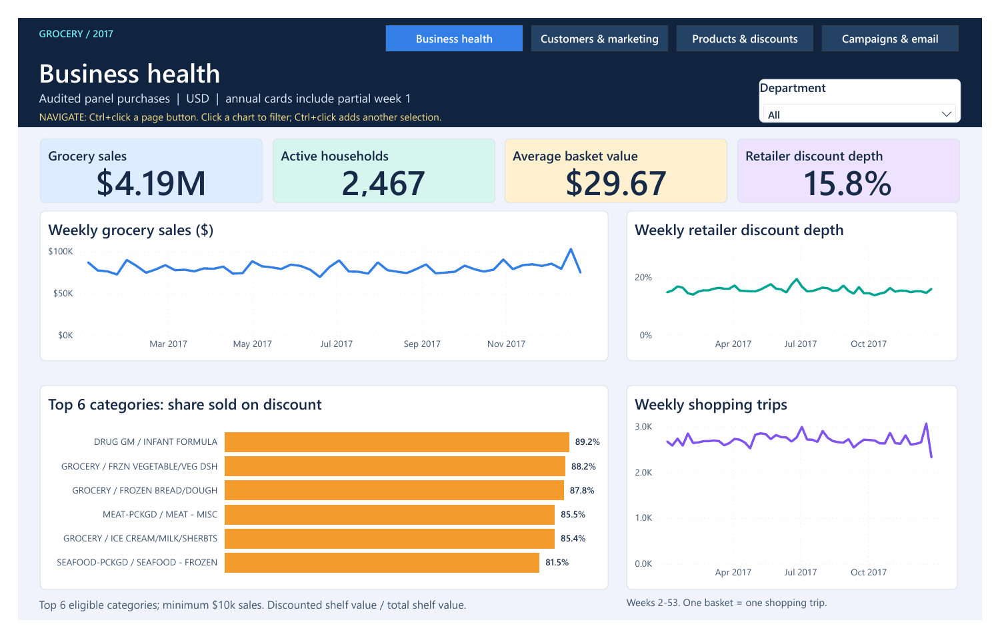
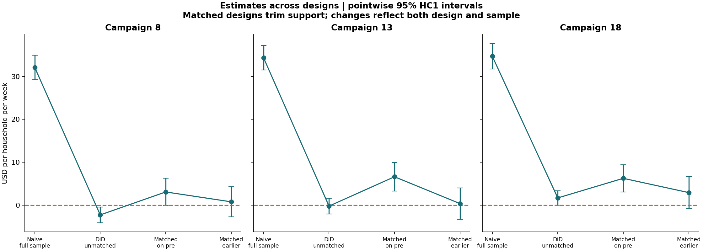
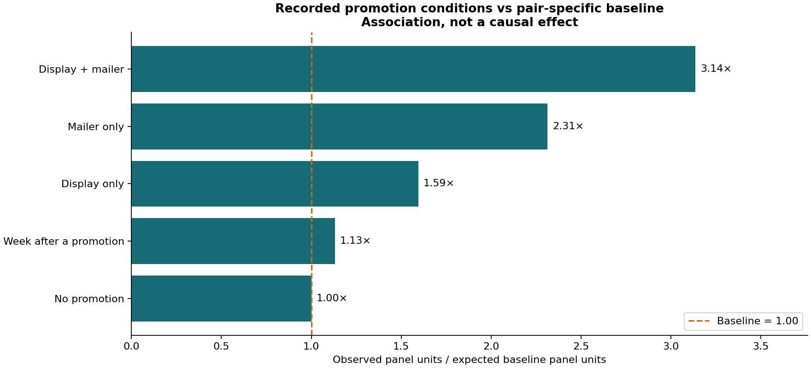

# Grocery Marketing Effectiveness

[](https://github.com/Aaad1tyaaA/grocery-marketing-effectiveness/actions/workflows/ci.yml)

**Recommend a randomized retention test before scaling grocery campaigns.** Campaign 18's raw $34.77 weekly household spend gap falls to an uncertain $2.95 after earlier-window matching (95% CI -$0.74 to $6.64). The analysis identifies customer concentration and discount dependence without presenting association as proven profit.

[Executive memo](docs/crm_recommendation_memo.pdf) · [Dashboard PDF](dashboard/Grocery%20Marketing%20Final.pdf) · [Dashboard source and controls](POWER_BI_START_HERE.md) · [Methods and definitions](docs/metric_glossary.md) · [Experiment readout](docs/experiment_readout.md) · [AI audit trail](docs/ai_log.md)






## Business questions and findings

| Question | Result | Decision implication |
|---|---|---|
| Who creates value? | 416 Champions account for 44.7% of grocery spend. | Protect valuable relationships; test retention actions rather than blanket discounts. |
| Where is spend declining? | 755 declining households show a $319,473 H1-to-H2 decrease. | Prioritize investigation; this is not an estimate of recoverable revenue. |
| Do grocery campaigns add sales? | All three earlier-match 95% intervals include zero. | Use a feasible randomized holdout before claiming incremental profit. |
| Are promotion placements effective? | Display + mailer is associated with 3.14x baseline panel units. | A descriptive association warrants testing; price and selection remain uncontrolled. |
| Does randomized evidence agree? | A separate email test supports +$0.77 per assigned customer for Men's merchandise email over two weeks. | Use it only within that experiment's population; do not transfer the dollar lift into grocery ROI. |

The four Power BI pages cover business health, customers/marketing, products/discounts and campaign/email evidence. The review-date text block is replaced by a weekly shopping-trip chart. Brand share uses bars, campaign designs use a compact comparison matrix, and unique-household coupon redemption rates replace mixed-unit counts. Ranked charts show six items; cohort activity shows months 0-5. All monetary amounts are source USD.

## Reproduce the analysis

Use Python 3.13. The first command installs pinned analysis/test dependencies; the second fetches checksum-pinned sources when absent, builds missing reporting databases, executes notebooks and validates results. Existing databases are preserved and verified. Disconnect local DBeaver reporting connections before rebuilding.

```text
python -m pip install -r requirements-hillstrom.txt -r requirements-tests.txt
python scripts/run_all.py
python -m pytest -q tests
```

Raw RDS/RDA, CSV and Parquet files and local DuckDB databases are excluded from this public repository. First setup requires downloading the source datasets and may take time and disk space. The original local handoff notebooks include executed results. Public notebook outputs are cleared to avoid republishing individual purchase rows; rerun them to regenerate outputs. The SQL files are the saved analysis.

## Open the dashboard and workbook

- Review the [four-page dashboard PDF](dashboard/Grocery%20Marketing%20Final.pdf) or the editable Power BI project. The original local handoff also contains `dashboard/Grocery Marketing Final.pbix`, with imported data for immediate viewing.
- To build the editable Power BI report: run the analysis, then `python scripts/export_dashboard_data.py`. Open `dashboard/final/Grocery Marketing Final.pbip` in Power BI Desktop and refresh. Set the `DataFolder` Power Query parameter to the absolute generated `dashboard/data` folder before refreshing. The public source uses the placeholder `C:\GroceryMarketing\dashboard\data`. Save as PBIX after refresh. Use **Ctrl+click** on the report's navigation buttons in Desktop edit mode.
- The embedded-data PBIX stays in the local handoff and is not uploaded. The Git repository contains editable report/model definitions and aggregated previews, not cached raw rows.
- The complete Excel ROI model is in the original local handoff (`excel/campaign_roi_model_v3.xlsx`); [its public specification](excel/README.md) documents the model. The workbook contains household lookup data and is kept out of the public repository. Blue cells are editable assumptions. Its positive point scenario is not a causal profit conclusion; compare uncertainty and test feasibility. The workbook was checked in desktop Excel, including sensitivity tables, Goal Seek, lookup/pivot features and edge cases.

## App preview

```text
python -m pip install -r app/requirements.txt
python -m streamlit run app/streamlit_app.py
```

The app uses small, committed summary CSVs, so the preview runs without the raw dataset. To host it on Streamlit Community Cloud, connect this repository and choose `app/streamlit_app.py`; requirements live alongside that file. Account connection and the final Cloud deployment are separate from the local AppTest checks.

## Repository map

| Folder | Contents |
|---|---|
| `sql/` | Saved modelling and numbered DBeaver analysis queries |
| `scripts/` | Pinned ingestion, model builders, exports and validation |
| `01_*.ipynb` through `06_*.ipynb` | Module walkthroughs; public outputs cleared |
| `tests/` | Synthetic regressions, data checks and app smoke tests |
| `app/` | Interactive summary app and small aggregate data |
| `dashboard/final/` | Editable Power BI report and semantic model source |
| `excel/` | Workbook specification; the data-bearing workbook remains local |
| `docs/` | Memo, cleaning log, glossary, verification, AI log and interview notes |

## Data sources and interpretation

Complete Journey comes from [bradleyboehmke/completejourney](https://github.com/bradleyboehmke/completejourney), pinned to commit `5b5d06192b9856edd04e4d405787af2f2e4a1fef`. This is a purchasing panel, not all store sales. Annual grocery totals are **$4,185,055.64**, **141,063 baskets** and **2,467 active grocery households**; the all-purchase cohort scope is 2,469. Partial source week 1 is included in annual KPIs and omitted from comparable weekly/H1-H2 trends.

The [Hillstrom experiment description](https://blog.minethatdata.com/2008/03/minethatdata-e-mail-analytics-and-data.html) concerns a different retailer and a two-week randomized email experiment. Download provenance and checksums are in `docs/hillstrom_source.json`; the scientific mirror copy is checksum-pinned, without claiming byte equality to the unavailable original endpoint. Targeting gains did not survive a split sensitivity check. Grocery campaign costs/margins are assumptions; demographics cover an engaged subset. Neither coupon redemption nor promotion associations prove causal lift.

## Verification and limits

`docs/module_verification.json` records the source, database, export and notebook checks. Dashboard-specific validation is in `dashboard/verification_final.json` (660 native DAX, saved-container and presentation checks; all four native PDF pages visually reviewed); Excel native validation is in `docs/excel/verification_v3.json`. CI runs synthetic and summary-data tests; tests requiring excluded raw files are skipped there, rather than pretending to rebuild the full dataset. Public deployment does not imply that a fresh computer has completed the full-data rebuild.

See [the resume and interview walkthrough](docs/resume_and_walkthrough.md), [design review](docs/dashboard_design_review.md), and [publication manifest](docs/publication_manifest.json).
