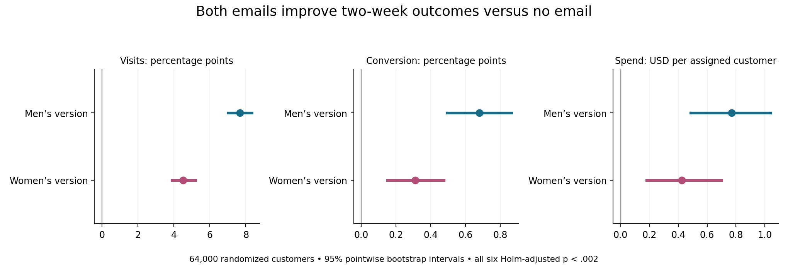
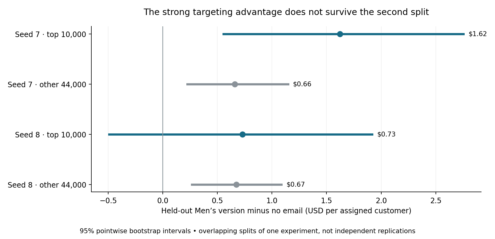
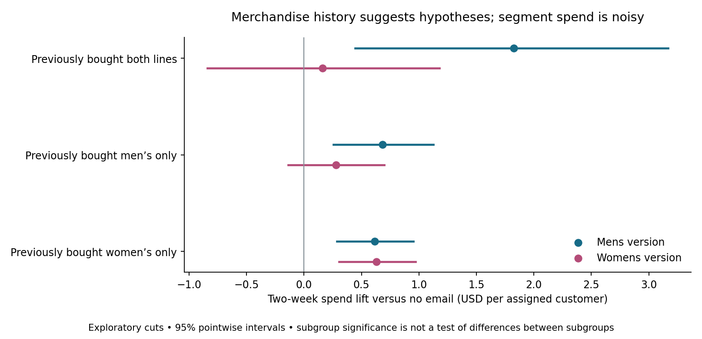

# Module 6 — Randomized email experiment

## Decision

Prefer the **Men's email version for the experiment population** over the Women's version or no email, based on two-week outcomes. Incremental spend is **+$0.77 per assigned customer** versus no email; Women's is **+$0.42**. The direct Men's-minus-Women's spend difference is **$0.35**, with 95% pointwise bootstrap CI **[$0.03, $0.65]** and Holm-adjusted p **0.0305** across the three head-to-head outcomes. Email costs, margin and longer-term effects are unavailable, so this is a revenue recommendation, not proven net ROI. Cell targeting remains provisional: its strong gain is not stable across split seeds.

## Design and checks

The [original experiment description](https://blog.minethatdata.com/2008/03/minethatdata-e-mail-analytics-and-data.html) describes customers with a purchase in the previous year, randomized among two merchandise emails and no email, followed for two weeks. The mirror contains **64,000 rows**: Men's **21,307**, Women's **21,387**, no email **21,306**. The equal-third sample-ratio test gives **p=0.9037**; no warning at the predeclared .01 threshold. The maximum absolute standardized baseline difference is **0.0137**. These checks detect some assignment/data issues; they do not prove every aspect of randomization was implemented correctly. Outcomes use all assigned customers, including zeros, rather than just buyers or email openers.

The original download endpoint could not be fetched with valid HTTPS in this environment. The included [scikit-uplift scientific mirror](https://github.com/maks-sh/scikit-uplift/blob/master/sklift/datasets/datasets.py) matches its published compressed MD5. The raw CSV SHA-256 is `00a6a868e05a9ffe7382da51629f6d6dce88c5acfc945e79d314ebc78fd3a2c0`. CSV and Parquet rows match exactly; source row order is preserved. This is a checksum-pinned mirror copy, without a claim of byte equality to the unavailable original. Provenance is in `docs/hillstrom_source.json`.

## Primary results

| Version | Outcome | No email | Email | Difference [95% CI] | Holm p |
| --- | --- | --- | --- | --- | --- |
| Mens E-Mail | visit | 10.62% | 18.28% | +7.66 [7.02, 8.33] pp | 8.19e-112 |
| Mens E-Mail | conversion | 0.57% | 1.25% | +0.68 [0.49, 0.86] pp | 6.01e-13 |
| Mens E-Mail | spend | $0.65 | $1.42 | +0.77 [0.48, 1.04] USD | 3.49e-07 |
| Womens E-Mail | visit | 10.62% | 15.14% | +4.52 [3.90, 5.19] pp | 1.22e-43 |
| Womens E-Mail | conversion | 0.57% | 0.88% | +0.31 [0.15, 0.47] pp | 0.000312 |
| Womens E-Mail | spend | $0.65 | $1.08 | +0.42 [0.18, 0.70] USD | 0.00113 |

Binary differences are **percentage points**, not percent changes. Spend is USD per assigned customer over two weeks. Intervals use 2,000 independent empirical row-bootstrap resamples per arm (seed 42); multinomial counts over repeated values produce the same bootstrap-mean distribution efficiently. Welch tests supply p values, with Holm adjustment across the six primary comparisons. Intervals remain **pointwise 95%**, not simultaneous Holm-adjusted intervals. All six primary comparisons reject zero at Holm .05. A separate three-test family supports the direct Men's-versus-Women's comparison on all three outcomes.

## Targeting: frozen training rule and held-out check

The Word guide's 36 theoretical cells combine merchandise history (both / men's only / women's only), newbie 0/1, recency 1–3 / 4–8 / 9–12 months, and prior spend **at least $200** / below $200. Only **30 cells occur**; the six both-lines/low-spend combinations are absent. We do not invent observations for empty cells. With seed 7, a random half trains cell spend lifts versus no email; each cell is ranked by its better training email. The other half evaluates frozen selections. No holdout outcome or assignment chooses a cell, version or tie break. Baseline cell counts from the full population only determine quota sizes.

The guide's whole-cell rule selects **8,486**, not exactly 10,000, and suppresses **9,420**. We retain that result separately as `guide_whole_cells`. To answer the exact-capacity question, a seeded outcome-free tie break fills the boundary cell, giving **10,000 target**, **10,000 suppress**, and **44,000 other**, with no overlap. The primary exact target rule is:

| Pre-treatment cell | Cell population | Selected | Training suggestion |
| --- | --- | --- | --- |
| both / 0 / 1-3 / high | 993 | 993 | Mens |
| both / 1 / 1-3 / high | 2040 | 2040 | Womens |
| womens only / 1 / 1-3 / high | 2447 | 2447 | Mens |
| womens only / 0 / 9-12 / high | 1404 | 1404 | Womens |
| mens only / 1 / 4-8 / high | 1602 | 1602 | Womens |
| mens only / 0 / 1-3 / low | 2631 | 1514 | Womens |

Read cells as `merchandise history | newbie | months since purchase | prior-spend band`. Newbie 1 denotes a new customer in the source definition. For example, `both|0|1-3|high` is an existing customer who bought both merchandise lines, purchased within three months, and spent at least $200 previously. Selection within a partly selected cell is random and fixed, not a claim that its selected individuals have higher uplift. Complete training means, counts, both seeds and decisions are in `policy_rules.csv` and `policy_assignments.csv`.

The exact suppression rule is:

| Pre-treatment cell | Cell population | Suppressed |
| --- | --- | --- |
| mens only / 0 / 9-12 / low | 3440 | 580 |
| womens only / 0 / 4-8 / low | 3368 | 3368 |
| mens only / 0 / 4-8 / high | 1708 | 1708 |
| mens only / 1 / 1-3 / high | 2438 | 2438 |
| both / 0 / 9-12 / high | 685 | 685 |
| both / 1 / 4-8 / high | 1221 | 1221 |

Suppression here means a forced capacity/budget scenario based on the lowest training scores. It does **not** show these customers are harmed by email, unprofitable, or should unsubscribe. The held-out suppression spend intervals include zero. Choosing cells that look poor on both training and validation would reuse validation to fit the rule; that was avoided.

| seed | audience | n_treatment | n_control | Lift [95% CI] | Holm p (72 tests) |
| --- | --- | --- | --- | --- | --- |
| 7 | target | 1718 | 1687 | $1.62 [0.56, 2.75] | 0.1613 |
| 7 | suppress | 1682 | 1689 | $0.68 [-0.15, 1.65] | 1.0 |
| 7 | other | 7402 | 7353 | $0.66 [0.23, 1.15] | 0.2794 |
| 8 | target | 1670 | 1651 | $0.73 [-0.49, 1.92] | 1.0 |
| 8 | suppress | 1676 | 1675 | $0.55 [-0.51, 1.64] | 1.0 |
| 8 | other | 7443 | 7338 | $0.67 [0.27, 1.09] | 0.079 |

Seed 7's whole-cell Men's lift is **$1.60** versus **$0.70** for its complement, matching the guide's rough point estimates. Its exact 10,000 target yields **$1.62** versus **$0.66** among the other 44,000. With the additional seed 8, exact target lift falls to **$0.73** versus **$0.67** for other customers, and the target interval crosses zero. **The strong targeting gain does not survive this sensitivity check.** The table's intervals are pointwise; its p values are Holm-adjusted over all 72 held-out fixed-arm comparisons. Seed 7 target-spend p after that adjustment is about .161. Splits overlap within one experiment and are not independent replications; the second seed was not used to optimize the chosen rule. A difference between subgroup point estimates alone is not a formal test of targeting gain.

The training-selected mix of Men's/Women's versions also lacks validation. On seed 7's held-out target, the learned policy's Horvitz–Thompson incremental spend is **$0.92** with 95% CI **[-0.002, 1.938]**; its paired difference versus always sending Men's is **$-0.74** **[-1.84, 0.37]**. This uses the known 1/3 assignment probability and accounts for the trained variant in each cell; averaging a subset's two fixed-arm lifts would not evaluate the mixed rule. Intervals condition on the fitted rule and do not cover all training-selection uncertainty. Use Men's as the population default; treat `recommended_email` as a training suggestion only.

`target_10000.csv` and `suppress_10000.csv` are reproducible research candidate lists, not production contact lists. `source_row` is a synthetic one-based CSV position; there is no real customer/email identifier. Lists include `population_default_email` and `variant_suggestion_status` so training version suggestions are not mistaken for validated recommendations. A fresh randomized validation with a frozen rule is needed before claiming a targeting advantage.

## Exploratory segment findings

All requested cuts are present: buyer merchandise history, newbie, channel, ZIP type, history segment and recency band; 126 outcome comparisons share one exploratory Holm family. Spend differences are noisy with few buyers. Different within-group significance does not establish a difference between groups; no confirmatory treatment-by-segment interaction claim is made. Men's email raises visits even for women's-only merchandise buyers:

| level | arm | Visit lift (pp) |
| --- | --- | --- |
| both | Mens E-Mail | 13.44 |
| both | Womens E-Mail | 7.11 |
| mens only | Mens E-Mail | 6.92 |
| mens only | Womens E-Mail | 1.11 |
| womens only | Mens E-Mail | 7.06 |
| womens only | Womens E-Mail | 7.4 |

## Answers to the eight guide questions

1. **Which email performed best?** Men's, with higher visits, conversion and spend than no email and than Women's in direct comparisons. This is about merchandise versions, not the sex or gender of customers.
2. **Incremental sales per customer?** Men's +$0.77 [0.48, 1.04]; Women's +$0.42 [0.18, 0.70], over two weeks, including all assigned customers.
3. **Best 10,000 to email?** The seed 7 frozen training ranking selects the six cells and boundary allocation shown above. It is a provisional research shortlist: the second split fails to confirm a strong advantage, so do not promise better results than broad Men's email from this ranking.
4. **Which 10,000 to suppress?** Use the frozen bottom-rank cells only if a capacity rule requires it; the exact list is exported. Evidence does not establish negative email effects for these customers.
5. **Do segments differ?** Descriptive point estimates vary by merchandise history, recency, channel and other baseline cuts. Small buyer counts and exploratory multiplicity make spend-based subgroup conclusions uncertain; differences between subgroup effects require direct interaction tests or a fresh experiment.
6. **Do outcomes differ?** Men's improves visits by 7.66 pp and conversion by 0.68 pp; Women's by 4.52 pp and 0.31 pp. Revenue gains are positive overall but less precise in small segments. Do not replace per-assigned revenue with per-buyer spend.
7. **Anomalies?** Only 578 customers have positive spend; 63,422 have zero, maximum spend is $499. Source label `Surburban` is retained. Only 30/36 possible cells exist; women's-only merchandise buyers respond to Men's, and target rankings change materially with the split.
8. **Who gets which version?** Men's is the supported population default. Training rules suggest Women's in some cells, but the held-out learned mix does not beat always-Men's, so no validated customer-level Women's allocation is established.

## Why this matters for Module 5

Random assignment supports a causal comparison of these email versions within this experiment's population and two-week horizon, subject to usual assumptions such as no outcome-changing interference. The grocery campaign analysis is observational and its best estimates remain uncertain. This separate retailer experiment illustrates the value of a randomized holdout; **its dollar lift must not be transferred into grocery campaign ROI** or presented as validation of the grocery estimates. Recommend a grocery-specific randomized holdout, measured costs and a preregistered primary outcome for the next campaign.

## Reproduce and inspect

Word guide steps 1.6.1–1.6.5 are covered. Open `06_hillstrom.ipynb` for executed outputs, `sql/06_hillstrom_learning.sql` for numbered DBeaver queries, `scripts/run_hillstrom.py` for the build, and `scripts/hillstrom_methods.py` for statistics. The run passed **27 database checks**. Unit tests cover bootstrap equivalence, frozen holdout isolation, exact disjoint quotas, unsupported cells, feature boundaries and policy-value arithmetic. The existing reporting database is protected from overwrite. The Excel workbook and recommendation memo are complete in the local handoff. The improved Power BI source is saved; its final PBIX/PDF export remains pending. See START_HERE.md for current publication status.
